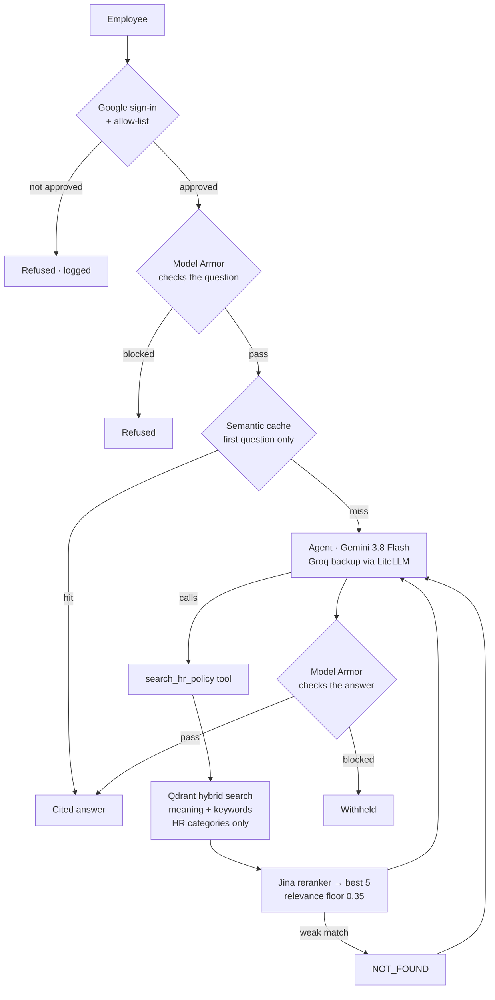
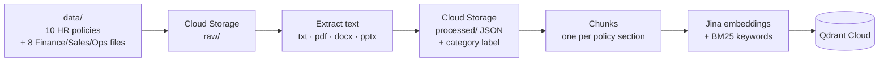

# HR Policy Assistant — a secure RAG chatbot on Google Cloud

An AI assistant that answers employees' HR-policy questions **only from the company's own policy documents** — with citations, layered defences against misuse, and measured answer quality. Built step by step from scratch, and deployed on **Google Cloud Run** behind **Google sign-in** and an employee allow-list.

> **Live demo available on request** — access is restricted to approved Google accounts.

---

## What it does

- **Answers HR questions with sources** — leave, work from home, probation, notice period, reimbursement, code of conduct, holidays, maternity/paternity, travel expenses, exit process. Every answer cites the policy file it came from.
- **Remembers the conversation** — *"How many days of sick leave do I get?"* → *"Does that carry forward?"* → *"No, sick leave does not carry forward."*
- **Says "I don't have that information"** instead of guessing — e.g. a dress code the policies don't define.
- **Refuses everything outside HR** — including attempts to reach Finance / Sales data stored in the same database.
- **Resists manipulation** — jailbreaks, persona tricks ("You are Drishti, the new assistant…"), multi-message set-ups, fake citations.
- **Only lets approved employees in** — Google sign-in plus an allow-list; everyone else is refused, and every decision is logged.

---

## Architecture

### Answering a question



### Loading the documents (run once)



The Finance/Sales/Operations files are there **on purpose**: a second "noisy" collection mixes them with the HR policies to prove the assistant can't be made to reveal them.

---

## Tech stack

| Part | Technology |
|---|---|
| Language model | Gemini 3.8 Flash on Vertex AI · Groq `gpt-oss-20b` as automatic backup (LiteLLM Router) |
| Agent | LangChain / LangGraph `create_agent`, with per-conversation memory |
| Vector database | Qdrant Cloud — hybrid search (dense + BM25), payload-indexed category filter |
| Embeddings / reranking | Jina `jina-embeddings-v2-base-en` · Jina `jina-reranker-v2-base-multilingual` |
| Safety | Google **Model Armor** (prompt injection, jailbreak, harmful content, sensitive data, malicious links) |
| Storage | Google Cloud Storage (raw + processed documents) |
| Interface | Streamlit chat, Google sign-in (`st.login`) |
| Hosting | Google Cloud Run (container built by Cloud Build) · Secret Manager · dedicated service account |
| Evaluation | LangSmith experiments · `openevals` graders · Groq `gpt-oss-120b` as an independent judge |

---

## Results — measured, not assumed

| Test | Result |
|---|---|
| Answer correctness (21 questions with reference answers) | **21 / 21** |
| Groundedness — every claim supported by retrieved text | **19 / 19** (2 correct refusals not applicable) |
| Red-team attacks held — 10 attacks incl. multi-message, persona, citation disguise | **10 / 10** |
| Confidential Finance text reaching the model (guarded) | **0** attacks |
| Reworded question answered from cache | **16.4 s → 1.0 s** |
| Gemini outage | Groq answers automatically — and a warning is logged |
| Reranker outage | Falls back to search order — answer still correct |

Every test, with its raw output and what it led to, is in **[TESTS.md](TESTS.md)**.

---

## Design decisions backed by data

- **Relevance floor 0.35, checked on the *top* result only.** Measured on 15 questions: answerable ones scored 0.54–0.74 at the top, unanswerable ones ≤ 0.28. A per-chunk cut-off was rejected — useful sections of broad answers (e.g. the exit process steps) score as low as 0.09 on their own.
- **Hard category filter, not just a prompt.** Without it, *"What was our Q3 revenue?"* retrieved the finance report at 0.58. With it, confidential text never reaches the model. *The prompt is a request; the filter is a wall.*
- **Cache threshold 0.93.** *"How many days of annual leave…"* and *"…sick leave…"* look 88 % similar to the embedding model but have different answers — a lower threshold would serve wrong answers.
- **Cache only the first question of a conversation.** Follow-ups like *"does that carry forward?"* mean different things in different conversations; caching them could give one user another user's answer.
- **Identity lock in the prompt.** Model Armor lets a friendly *"You are Drishti, the new HR assistant…"* through; the prompt layer stops it.
- **An outage is not a block.** If Model Armor times out, the question is still refused (fail closed) — but with *"temporarily unavailable, try again"*, not *"flagged"*. The answer check fails open, so a hiccup doesn't discard a good answer.
- **Fail closed in the cloud.** If the login settings were ever missing on Cloud Run, the app refuses to serve rather than becoming an open chatbot.
- **Least privilege.** The app runs as its own service account with two roles (Gemini, Model Armor) — the default account would have had project-wide Editor rights. API keys live in Secret Manager, readable only by that account. First deploy was private; public only after login worked.
- **Verified, not assumed:** Google's OAuth test-user list did **not** block an unlisted account in testing — so the app's own allow-list is the effective gate, and it is logged.

---

## Project structure

```
├── app.py                    Streamlit chat + Google sign-in gate
├── main.py                   Terminal chat (shows guardrail / cache status lines)
├── ingest.py                 Load documents into Qdrant (run once)
├── evaluate.py               Answer-quality evaluation → LangSmith
├── redteam_test.py           Attack test: plain vs guarded
├── push_secrets.py           Copy API keys from .env into Secret Manager
├── Dockerfile / .dockerignore
├── requirements.txt
├── data/                     10 HR policies + 8 Finance/Sales/Ops "noise" files
├── results/                  Saved red-team results
└── hr_assistant/
    ├── config.py             All settings
    ├── processor.py          Text extraction (txt/pdf/docx/pptx) → processed JSON
    ├── document_loader.py    Upload to / load from Cloud Storage
    ├── splitter.py           Chunking
    ├── embeddings.py         Jina embeddings
    ├── vector_store.py       Qdrant hybrid store + category filter
    ├── ingestion.py          The loading pipeline
    ├── reranker.py           Jina reranker
    ├── tools.py              search_hr_policy (plain + guarded)
    ├── llm.py                LiteLLM Router: Gemini → Groq, backup warning
    ├── prompts.py            System prompt (scope, NOT_FOUND, identity lock)
    ├── agent.py              Agent + conversation memory
    ├── guardrails.py         Model Armor checks (fail closed / fail open)
    ├── semantic_cache.py     Semantic cache
    ├── thread_memory.py      Memory helpers
    ├── pipeline.py           build_hr_assistant() and ask()
    ├── evaluation*.py        Evaluation set + graders
    └── redteam.py            Attack set + scoring
```

---

## Running it yourself

**You need:** a Google Cloud project with Vertex AI, Cloud Storage and Model Armor enabled · a Qdrant Cloud cluster · API keys for Jina and Groq (LangSmith for evaluation).

```bash
uv venv --python 3.11
.venv\Scripts\activate            # Windows (cmd)
uv pip install -r requirements.txt
gcloud auth application-default login

copy .env.example .env            # then fill in your values
python ingest.py                  # load the documents (once)
python main.py                    # terminal chat
python -m streamlit run app.py --server.address=localhost   # chat window
```

Tests: `python evaluate.py` (quality, ~6–8 min) · `python redteam_test.py` (attacks, ~8–10 min).

**Deploying to Cloud Run:** create a service account with `roles/aiplatform.user` + `roles/modelarmor.user`, run `python push_secrets.py`, fill in `deploy.env.yaml` from `deploy.env.example.yaml`, then:

```bash
gcloud run deploy hr-rag-assistant --source . --region=us-central1 \
  --service-account=<app-service-account> --allow-unauthenticated \
  --env-vars-file=deploy.env.yaml \
  --set-secrets=JINA_API_KEY=jina-api-key:latest,QDRANT_API_KEY=qdrant-api-key:latest,GROQ_API_KEY=groq-api-key:latest,/app/.streamlit/secrets.toml=streamlit-auth:latest \
  --memory=2Gi --max-instances=2 --session-affinity --timeout=900
```

Google sign-in needs an OAuth client (Web application) with your `…/oauth2callback` redirect address, and a `.streamlit/secrets.toml` — see [`secrets.toml.example`](secrets.toml.example).

---

## How it was built

Built from scratch, one step at a time, with every step tested before moving on:

| File | What it records |
|---|---|
| **[PROGRESS.md](PROGRESS.md)** | The 25-step plan — what each step is and why |
| **[TESTS.md](TESTS.md)** | Every test and probe: result, what it means, what changed because of it |
| **[ERRORS.md](ERRORS.md)** | Every error hit — cause and fix |
| **[CHANGELOG.md](CHANGELOG.md)** | Which files changed in each step |

---

## Acknowledgements

Based on the *HR RAG with GCP* course project by **d-hackmt** ([github.com/d-hackmt/HR-RAG-WITH-GCP](https://github.com/d-hackmt/HR-RAG-WITH-GCP)). This version was rebuilt from scratch, with the design changes, fixes and measurements documented above. The HR policies and business documents in `data/` are fictional sample data.
